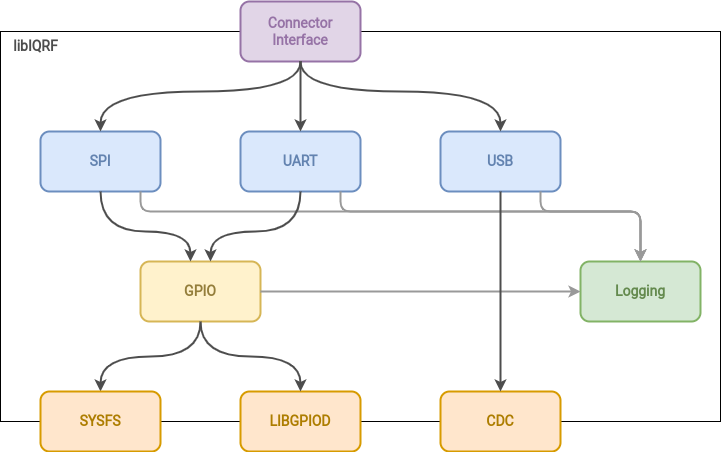

# libiqrf

[](https://gitlab.iqrf.org/open-source/iqrf-sdk/libiqrf/pipelines)
[](https://gitlab.iqrf.org/open-source/iqrf-sdk/libiqrf/-/commits/master)
[](https://apidocs.iqrf.org/libiqrf/master/)
[](LICENSE)

## Description

This repository contains the IQRF libraries for C/C++.



### Libraries

- [`libiqrf-connector-cdc`](src/connector/cdc) - CDC connector library
- [`libiqrf-connector-spi`](src/connector/spi) - SPI connector library (Linux spidev)
- [`libiqrf-connector-tcp`](src/connector/tcp) - TCP connector library (POSIX sockets, Winsock)
- [`libiqrf-connector-uart`](src/connector/uart) - UART connector library
- [`libiqrf-gpio`](src/gpio) - GPIO library
- [`libiqrf-log`](src/log) - Logging library

## Dependencies

### Build tools

- [CMake](https://cmake.org/) >= 3.18
- [ccache](https://ccache.dev/) >= 3.7 (optional)

### Libraries

- [Boost](https://www.boost.org/) (log, program_options, system)
- [libgpiod](https://libgpiod.readthedocs.io/en/latest/index.html) >= 1.6.2
- [libserialport](https://sigrok.org/wiki/Libserialport)

### Testing
- [GTest](https://google.github.io/googletest/)
- [Clang](https://clang.llvm.org/) with [libFuzzer](https://llvm.org/docs/LibFuzzer.html) (fuzzing only)

## Build

```bash
git clone https://gitlab.iqrf.org/open-source/iqrf-sdk/libiqrf.git
cd libiqrf/
mkdir build
cmake -Bbuild -H. -DCMAKE_BUILD_TYPE=Debug -DBUILD_STATIC=TRUE -DUSE_CCACHE=TRUE
cmake --build build
```

### Build options

| Option                  | Type    | Default | Description                      |
|-------------------------|---------|---------|----------------------------------|
| `BUILD_DOCS`            | boolean | False   | Build documentation with Doxygen |
| `BUILD_EXAMPLES`        | boolean | True    | Build examples                   |
| `BUILD_FUZZERS`         | boolean | False   | Build libFuzzer fuzz targets²    |
| `BUILD_SHARED`          | boolean | True    | Build shared libraries           |
| `BUILD_STATIC`          | boolean | False   | Build static libraries           |
| `BUILD_TESTING_SUPPORT` | boolean | True    | Build testing support (mocks)¹   |
| `BUILD_TESTS`           | boolean | True    | Build tests                      |
| `CODE_COVERAGE`         | boolean | False   | Enable code coverage             |
| `FUZZ_SANITIZERS`       | string  | `address,undefined` | Sanitizers used for fuzzing |
| `USE_CCACHE`            | boolean | False   | Use ccache for compilation       |

¹ Always enabled when `BUILD_TESTS` is enabled.

² Requires Clang, all libraries are instrumented with the sanitizers.

## Test

```bash
cd build/test/
ctest
```

## Fuzzing

Fuzz targets in `fuzz/` exercise the parsers of the data received from the devices (HDLC frames, USB CDC frames,
SPI responses and the TR module information).

```bash
make fuzz  # or e.g. make fuzz FUZZ_CC=clang-21 FUZZ_CXX=clang++-21
# Replay the seed corpora
ctest --test-dir build-fuzz/fuzz
# Fuzz the target, new inputs are stored in the working corpus directory
mkdir -p corpus/CdcProtocol
build-fuzz/bin/fuzz_CdcProtocol corpus/CdcProtocol fuzz/corpus/CdcProtocol
```
